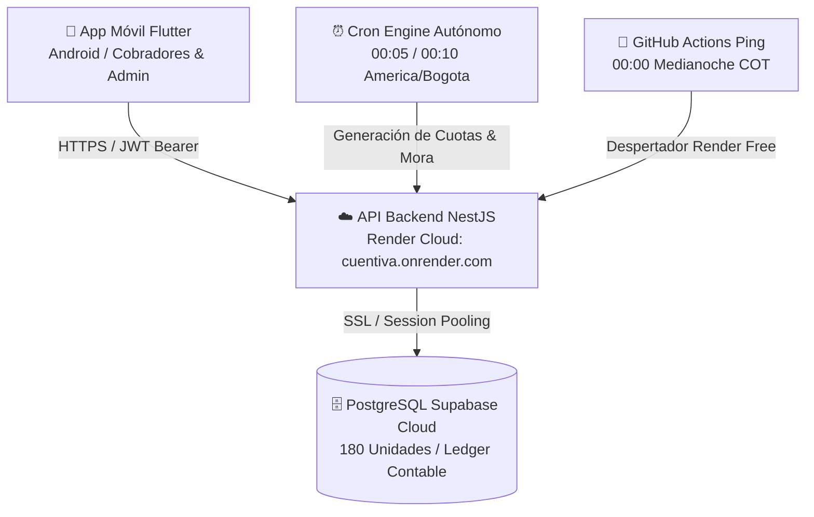

# 🏢 Cuentiva Platform

<p align="center">
  
  <br>
  <strong>Plataforma Inteligente de Gestión de Recaudo y Administración Residencial</strong>
  <br>
  <em>Diseñada para urbanizaciones, condominios y conjuntos cerrados de alta exigencia.</em>
</p>

<p align="center">
  <a href="https://github.com/Cuentiva/Cuentiva-platform/releases/tag/v1.0.0">
    
  </a>
  <a href="https://cuentiva.onrender.com/api/health">
    
  </a>
  <a href="https://supabase.com">
    
  </a>
  
</p>

---

## 📲 Descarga Oficial de la App Móvil (Android)

La versión oficial de producción para dispositivos Android ya está disponible con enlace directo a la nube de Render y base de datos Supabase:

| Artefacto | Plataforma | Tamaño | Descarga Directa |
| :--- | :--- | :--- | :--- |
| **Cuentiva Mobile APK** | Android (Arm64/v7a/x86_64) | ~63.3 MB | [📥 Descargar cuentiva-mobile-v1.0.0.apk](https://github.com/Cuentiva/Cuentiva-platform/releases/download/v1.0.0/cuentiva-mobile-v1.0.0.apk) |
| **Sumas de Verificación** | Criptográfica | 93 B | [📄 Ver SHA256SUMS.txt](https://github.com/Cuentiva/Cuentiva-platform/releases/download/v1.0.0/SHA256SUMS.txt) |

### 🔒 Verificación de Integridad SHA-256
Para garantizar que el instalador no ha sido alterado:
```bash
sha256sum -c SHA256SUMS.txt
# Resultado esperado:
# cuentiva-mobile-v1.0.0.apk: OK
```
**Hash SHA-256 Oficial**:
`c36089ac0ca5a383ff4bb1ee2f2629b14ddea28a0fb5277e7380e43e8f81e284`

---

## 🏗️ Arquitectura del Sistema



### Componentes Clave:
1. **Backend Cloud**:
   - NestJS 10 + TypeORM en Node.js 20.
   - Aislamiento estricto multi-inquilino (`tenant_id`).
   - Sincronización horaria con **Colombia** (`America/Bogota`).
   - Motor de facturación idempotente protegido con `pg_advisory_xact_lock`.
2. **Base de Datos Cloud**:
   - PostgreSQL en **Supabase Cloud Pooler** con conexión SSL cifrada.
   - Esquema inmutable para libro mayor contable (Ledger).
   - Volumen activo: 180 casas con residentes, contratos y planes de cobro.
3. **App Móvil Multiplataforma**:
   - Flutter 3.x con Clean Architecture y Riverpod.
   - Base de datos local SQLite (Drift) con capacidad de trabajo offline y sincronización bidireccional.
   - Soporte nativo para impresoras térmicas Bluetooth (recibos físicos con QR y hash anti-fraude).

---

## 🔑 Credenciales de Demostración y Prueba en Vivo

Puedes iniciar sesión en la aplicación móvil o probar la API REST utilizando las siguientes credenciales preconfiguradas:

### 1. Perfil Cobrador de Ruta
* **Usuario:** `ricardoarrietacobrador`
* **Contraseña:** `ricardoArrieta2026.`
* **Capacidades:**
  * Visualización de ruta de cobro organizada por Etapas (Etapa 1 y 2) y Manzanas (A, B, C).
  * Registro de cobros en efectivo o transferencia.
  * Impresión de recibos térmicos por Bluetooth.
  * Filtro por sábados de recaudo (R1, R2, R3, R4) para residentes semanales.

### 2. Perfil Administrador General
* **Usuario:** `admin_cuentiva`
* **Contraseña:** `Cuentiva2026*Admin!`
* **Capacidades:**
  * Dashboard financiero consolidado con métricas de recaudación y cartera.
  * Gestión global de tarifas y proyectos.
  * Auditoría de cobros, pagos y estados de cuenta.

---

## ⚡ Reglas de Negocio Automatizadas

- **Modalidad Semanal**: 4 cuotas mensuales programadas en los cuatro sábados de cada mes (R1, R2, R3, R4).
- **Modalidad Quincenal**: 2 cuotas mensuales programadas los días 15 y 30.
- **Modalidad Mensual**: 1 cuota mensual programada el último día del mes.
- **Morosidad Autónoma**: Cada noche a las **00:10 (hora Colombia)**, el motor de cartera revisa cuotas impagas cuya fecha de vencimiento haya expirado y actualiza su estado a `VENCIDA` sin intervención humana.

---

## 🛠️ Instalación en Dispositivos Android

1. Descarga el archivo `cuentiva-mobile-v1.0.0.apk` en tu dispositivo o envíalo por WhatsApp / Telegram / Google Drive.
2. Al abrir el archivo, si el sistema te solicita permisos para **"Instalar aplicaciones de fuentes desconocidas"**, acéptalo para tu navegador o explorador de archivos.
3. Presiona **Instalar**.
4. Abre la app e ingresa con las credenciales de prueba. La app se conectará automáticamente a la nube en `https://cuentiva.onrender.com/api`.

---

<p align="center">
  <strong>Desarrollado con pasión para la modernización del recaudo residencial.</strong><br>
  © 2026 Cuentiva Inc. Todos los derechos reservados.
</p>