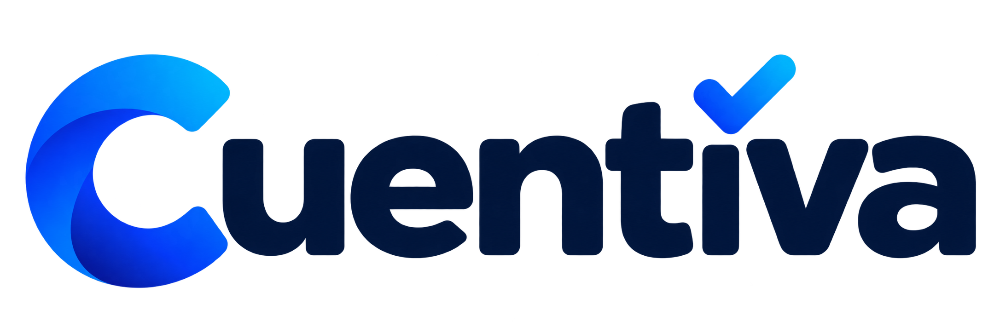

# 🏢 Cuentiva Platform

<p align="center">
  
  <br>
  
  <br><br>
  <strong>Plataforma Inteligente de Gestión de Recaudo y Administración Residencial</strong>
  <br>
  <em>Solución integral para urbanizaciones, condominios y conjuntos residenciales.</em>
</p>

<p align="center">
  <a href="https://github.com/Cuentiva/Cuentiva-platform/releases/tag/v0.3.1">
    
  </a>
  
  
</p>

---

## 🌟 Características Principales

* 📶 **Operación Fuera de Línea (Offline-First)**: Registro de cobros y consultas sin depender de conexión permanente a internet, con sincronización automática en la nube al recuperar señal.
* 🖨️ **Impresión Térmica Bluetooth**: Emisión instantánea de comprobantes de pago físicos en impresoras térmicas portátiles (58mm / 80mm) con código QR de verificación.
* 📍 **Rutas Inteligentes de Cobro**: Organización dinámica por etapas, manzanas y viviendas, optimizando los tiempos del cobrador.
* 📅 **Modalidades Flexibles**: Soporte para planes de recaudo semanales, quincenales y mensuales adaptados a la comunidad.
* 🛡️ **Trazabilidad y Seguridad**: Comprobantes firmados criptográficamente para evitar duplicidades y fraudes.

---

## 📦 Descargas Oficiales (Versión Oficial v0.3.1)

| Plataforma | Versión | Fecha | Formato | Tamaño | Enlace de Descarga |
| :--- | :---: | :---: | :---: | :---: | :--- |
| 📱 **Android** | `v0.3.1` | 27/Oct/2026 | `.apk` | ~67 MB | [📥 **Descargar para Android**](https://github.com/Cuentiva/Cuentiva-platform/releases/download/v0.3.1/cuentiva-mobile-v0.3.1.apk) |
| 🐧 **Linux Desktop** | `v0.3.1` | 27/Oct/2026 | `.tar.gz` (x64) | ~15 MB | [📥 **Descargar para Linux**](https://github.com/Cuentiva/Cuentiva-platform/releases/download/v0.3.1/cuentiva-desktop-linux-x64-v0.3.1.tar.gz) |
| 🪟 **Windows Desktop** | `v0.3.1` | 27/Oct/2026 | `.zip` (x64) | ~16 MB | [📥 **Descargar para Windows**](https://github.com/Cuentiva/Cuentiva-platform/releases/download/v0.3.1/cuentiva-desktop-windows-x64-v0.3.1.zip) |
| 🌐 **Aplicación Web** | `v0.3.1` | 27/Oct/2026 | `PWA / Web` | En línea | [🚀 **Abrir Cuentiva Web**](https://cuentiva.github.io/Cuentiva-platform/) |
| 📄 **Verificación** | `v0.3.1` | 27/Oct/2026 | `.txt` | SHA-256 | [📄 **Ver SHA256SUMS.txt**](https://github.com/Cuentiva/Cuentiva-platform/releases/download/v0.3.1/SHA256SUMS.txt) |

--- | :---: | :---: | :---: | :---: | :--- |
| 📱 **Android** | `v1.0.0` | 08/Sep/2026 | `.apk` | ~63.3 MB | [📥 **Descargar para Android**](https://github.com/Cuentiva/Cuentiva-platform/releases/download/v1.0.0/cuentiva-mobile-v1.0.0.apk) |
| 🐧 **Linux Desktop** | `v1.0.0` | 08/Sep/2026 | `.tar.gz` (x64) | ~11.6 MB | [📥 **Descargar para Linux**](https://github.com/Cuentiva/Cuentiva-platform/releases/download/v1.0.0/cuentiva-desktop-linux-x64-v1.0.0.tar.gz) |
| 🪟 **Windows Desktop** | `v1.0.0` | 08/Sep/2026 | `.zip` (x64) | ~13.8 MB | [📥 **Descargar para Windows**](https://github.com/Cuentiva/Cuentiva-platform/releases/download/v1.0.0/cuentiva-desktop-windows-x64-v1.0.0.zip) |
| 📄 **Verificación** | `v1.0.0` | 08/Sep/2026 | `.txt` | 306 B | [📄 **Ver SHA256SUMS.txt**](https://github.com/Cuentiva/Cuentiva-platform/releases/download/v1.0.0/SHA256SUMS.txt) |

---

### 🔒 Sumas de Verificación Criptográfica (SHA-256)

Para validar que los instaladores descargados no han sido alterados:

```bash
sha256sum -c SHA256SUMS.txt
```

**Hashes Oficiales:**
```text
c36089ac0ca5a383ff4bb1ee2f2629b14ddea28a0fb5277e7380e43e8f81e284  cuentiva-mobile-v1.0.0.apk
49430dd1b5576b0a313b9c5f302910c32a2887473f8eb5795d32101590491377  cuentiva-desktop-linux-x64-v1.0.0.tar.gz
ae7d73a07de58ce7580546e8b5931eade61e55361851fd325f606688b329c3ef  cuentiva-desktop-windows-x64-v1.0.0.zip
```

---

## 🚀 Guías de Instalación y Uso

### 📱 Android (Teléfonos y Tablets)

1. Descargue el instalador `cuentiva-mobile-v1.0.0.apk` en su dispositivo.
2. Abra el archivo desde el gestor de descargas de su navegador o explorador de archivos.
3. Si el sistema muestra una advertencia sobre aplicaciones de fuentes desconocidas, seleccione **Ajustes** y active la opción **Permitir desde esta fuente**.
4. Toque **Instalar** y luego **Abrir** para iniciar la plataforma.

---

### 🐧 Linux Desktop

El paquete para Linux es totalmente autónomo y no requiere instalación ni privilegios de administrador:

```bash
# 1. Descomprimir el archivo descargado
tar -xzf cuentiva-desktop-linux-x64-v1.0.0.tar.gz -C cuentiva/
cd cuentiva

# 2. Ejecutar la aplicación
./civica_pago_mobile
```

**Requisitos mínimos**: Distribución Linux x86_64 con entorno gráfico estándar (librería `libgtk-3`, presente en Ubuntu, Debian, Fedora, Arch, Manjaro, Linux Mint, etc.).

---

### 🪟 Windows Desktop (Windows 10 / 11 de 64 bits)

La versión de escritorio para Windows está diseñada para administradores, contadores y cajas de recaudo en oficina:

1. Descargue el archivo **`cuentiva-desktop-windows-x64-v1.0.0.zip`**.
2. Haga clic derecho sobre el archivo descargado y seleccione **Extraer todo...**.
3. Abra la carpeta extraída y haga doble clic en **`civica_pago_mobile.exe`**.
4. ¡Listo! La aplicación se iniciará al instante conectada a la nube.

> *Nota: Es una aplicación totalmente portable; no requiere permisos de administrador ni instalación invasiva en el sistema.*

---

## 📋 Requisitos de Sistema Recomendados

* **Dispositivos Móviles (Cobradores en Ruta)**:
  * Android 8.0 (Oreo) o superior.
  * Conectividad Bluetooth 4.0+ (para impresoras térmicas portátiles).
  * 2 GB de memoria RAM o superior.
* **Equipos de Escritorio (Administración y Auditoría)**:
  * Procesador x86_64 dual core a 1.5 GHz o superior.
  * 4 GB de memoria RAM.
  * Pantalla con resolución mínima de 1280x720.

---

## 📞 Soporte y Contacto

Para consultas comerciales, soporte de implementación o capacitación para su comunidad residencial:
* **Organización**: Cuentiva Platform
* **Portal Oficial**: [https://github.com/Cuentiva](https://github.com/Cuentiva)

---

<p align="center">
  <strong>Cuentiva Platform — Eficiencia, transparencia y control para su comunidad.</strong><br>
  © 2026 Cuentiva. Todos los derechos reservados.
</p>
