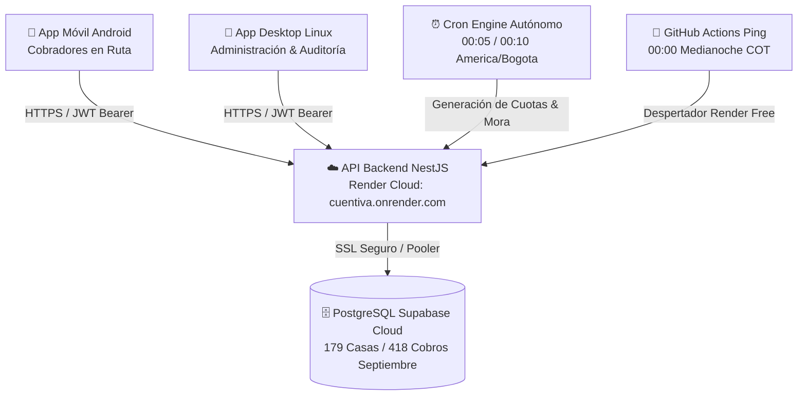

# 🏢 Cuentiva Platform

<p align="center">
  
  <br>
  <strong>Plataforma Inteligente de Gestión de Recaudo y Administración Residencial</strong>
  <br>
  <em>Diseñada para urbanizaciones, condominios y conjuntos cerrados de alta exigencia.</em>
</p>

<p align="center">
  <a href="https://github.com/Cuentiva/Cuentiva-platform/releases/tag/v1.0.0">
    
  </a>
  <a href="https://cuentiva.onrender.com/api/health">
    
  </a>
  <a href="https://supabase.com">
    
  </a>
  
</p>

---

## 📦 Descargas Oficiales Multiplataforma (v1.0.0)

El cliente de **Cuentiva** está diseñado con Flutter y soporta ejecución multiplataforma. Todas las versiones se conectan directamente a la API en la nube (`https://cuentiva.onrender.com/api`) y a la base de datos Supabase:

| Plataforma | Tipo de Paquete | Formato | Tamaño | Enlace de Descarga |
| :--- | :--- | :--- | :--- | :--- |
| **Android** | Móvil (Arm64/v7a/x86_64) | `.apk` | ~63.3 MB | [📥 Descargar APK para Android](https://github.com/Cuentiva/Cuentiva-platform/releases/download/v1.0.0/cuentiva-mobile-v1.0.0.apk) |
| **Linux Desktop** | Binario Portable (x86_64) | `.tar.gz` | ~11.6 MB | [📥 Descargar Tarball para Linux](https://github.com/Cuentiva/Cuentiva-platform/releases/download/v1.0.0/cuentiva-desktop-linux-x64-v1.0.0.tar.gz) |
| **Windows Desktop** | Portable / Setup (x86_64) | `.zip` / `.exe` | *Próximamente* | [💻 Ver estado de versión Windows](#-guía-para-windows-desktop) |
| **Verificación** | Sumas SHA-256 | `.txt` | 200 B | [📄 Ver SHA256SUMS.txt](https://github.com/Cuentiva/Cuentiva-platform/releases/download/v1.0.0/SHA256SUMS.txt) |

---

### 🔒 Sumas de Verificación Criptográfica (SHA-256)

Para comprobar la autenticidad e integridad de los archivos descargados:

```bash
sha256sum -c SHA256SUMS.txt
```

**Hashes Oficiales:**
```
c36089ac0ca5a383ff4bb1ee2f2629b14ddea28a0fb5277e7380e43e8f81e284  cuentiva-mobile-v1.0.0.apk
49430dd1b5576b0a313b9c5f302910c32a2887473f8eb5795d32101590491377  cuentiva-desktop-linux-x64-v1.0.0.tar.gz
```

---

## 🚀 Guías de Instalación y Ejecución por Plataforma

### 🐧 Guía para Linux Desktop (Ubuntu, Debian, Fedora, Arch, CachyOS)

El paquete de Linux es un **paquete portable nativo**: no requiere instalar Flutter, Node ni compilar nada.

#### 1. Descarga y Descompresión:
```bash
# 1. Descargar el archivo comprimido
wget https://github.com/Cuentiva/Cuentiva-platform/releases/download/v1.0.0/cuentiva-desktop-linux-x64-v1.0.0.tar.gz

# 2. Descomprimir el paquete
tar -xzf cuentiva-desktop-linux-x64-v1.0.0.tar.gz -C cuentiva-linux/
cd cuentiva-linux
```

#### 2. Ejecutar la Aplicación:
```bash
./civica_pago_mobile
```

#### 💡 Dependencias del Sistema (Normalmente preinstaladas en sistemas con escritorio):
* `libgtk-3-0` (Librería gráfica GTK3)
* `libsoup-3.0` o `libsoup2.4`
* `libsqlite3-0`

Si estás en una instalación mínima de Ubuntu/Debian:
```bash
sudo apt update && sudo apt install -y libgtk-3-0 libsoup-3.0-0 libsqlite3-0
```

---

### 📱 Guía para Dispositivos Android (Móviles y Tablets)

1. Descarga el archivo `cuentiva-mobile-v1.0.0.apk` directamente en tu teléfono o transmítelo vía USB/WhatsApp/Drive.
2. Abre el archivo descargado desde tu gestor de archivos o navegador.
3. Si el sistema muestra el mensaje de seguridad de Android:
   > *"Por motivos de seguridad, tu teléfono no tiene permitido instalar apps desconocidas de esta fuente"*,
   haz clic en **Ajustes** y activa la casilla **"Permitir desde esta fuente"**.
4. Pulsa **Instalar** y luego **Abrir**.
5. La app iniciará conectada de forma autónoma con la nube de Render y la base de datos Supabase.

---

### 🪟 Guía para Windows Desktop

#### ¿Cómo es el estándar de publicación de aplicaciones Flutter en Windows?
Flutter en Windows no compila un único archivo `.exe` aislado; genera una carpeta de ejecución que contiene:
* `cuentiva.exe`: El lanzador ejecutable principal.
* `flutter_windows.dll`: El motor gráfico Skia/Impeller embebido.
* Librerías DLL de plugins (almacenamiento seguro, SQLite, etc.).
* Carpeta `data/`: Assets, fuentes y configuraciones compiladas.

#### Métodos de Distribución:
1. **Paquete Portable (.zip)**:
   Se descarga el `.zip`, se descomprime en cualquier carpeta (ej. `C:\Program Files\Cuentiva` o el Escritorio) y se hace doble clic en `cuentiva.exe`.
2. **Instalador Oficial (.exe / InnoSetup)**:
   Es el estándar comercial en Windows. Un archivo instalador único (ej. `cuentiva-setup-v1.0.0.exe`) que despliega el paquete, registra la aplicación en el Panel de Control ("Agregar o quitar programas") y crea accesos directos en el Menú Inicio y en el Escritorio.

---

## 🏗️ Arquitectura de la Solución Cloud



---

## 🔑 Credenciales de Demostración y Prueba en Vivo

El sistema cuenta con datos de prueba realistas cargados en la nube:

### 1. Perfil Cobrador de Ruta
* **Usuario:** `ricardoarrietacobrador`
* **Contraseña:** `ricardoArrieta2026.`
* **Capacidades:**
  * Recorrido de cobro por Etapas (1 y 2) y Manzanas (A, B, C).
  * 418 cuotas asignadas para septiembre de 2026.
  * Impresión térmica Bluetooth de comprobantes físicos.
  * Filtro de sábados semanales (R1, R2, R3, R4).

### 2. Perfil Administrador General
* **Usuario:** `admin_cuentiva`
* **Contraseña:** `Cuentiva2026*Admin!`
* **Capacidades:**
  * Dashboard consolidado con balance global de recaudo.
  * Supervisión de estados de cuenta y cartera morosa.
  * Auditoría y configuración de tarifas.

---

## ⚡ Automatización Contable y Reglas de Negocio

* **Planes Semanales**: 4 cuotas mensuales programadas en los 4 sábados de cada mes (R1 a R4).
* **Planes Quincenales**: 2 cuotas mensuales programadas los días 15 y 30.
* **Planes Mensuales**: 1 cuota mensual programada el último día del mes.
* **Motor de Mora Autónomo**: Todas las noches a las **00:10 (hora Colombia)**, el motor de cartera revisa cuotas impagas cuya fecha de vencimiento haya expirado y las marca como `VENCIDA` en el libro contable inmutable.

---

<p align="center">
  <strong>Cuentiva Inc. — Plataforma Líder en Modernización del Recaudo Residencial</strong><br>
  © 2026 Cuentiva. Todos los derechos reservados.
</p>